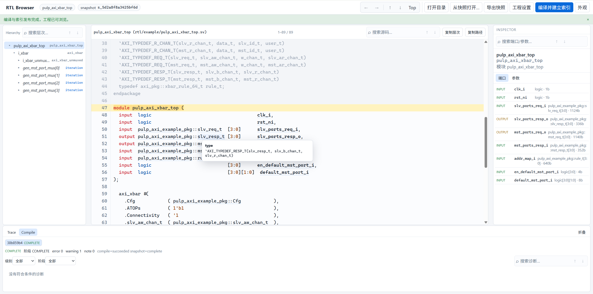

# RTL Browser



RTL Browser 是一个本地运行的 WebUI RTL 浏览器。选择一个工程目录，使用 slang 编译并建立只读语义快照，然后浏览层次结构、源码、悬停信息、Driver、Load、实例端口/参数和编译报告。

- 运行在本机 `127.0.0.1`，不上传工程、不访问 CDN、不修改源 RTL。
- 服务端使用 Node.js，原生索引器使用 C++20 + slang 12，快照存储在项目内的 `.rtlb`。
- 当前项目是可运行的垂直切片，不是完整商业产品。

## 功能

- **层次结构**：模块实例、generate scope、端口和参数。
- **源码浏览**：完整文件、可折叠的层次视图、源码搜索和行内匹配高亮。
- **语义导航**：信号/参数/类型/package/宏 hover 与跳转，Driver/Load Trace，端口 actual 和参数覆盖追踪。
- **作用域灰显**：同文件其他模块、未生效的 generate 分支，以及当前宏配置下未选中的 `ifdef`/`ifndef`/`elsif`/`else` 分支（支持多层嵌套）。
- **Inspector**：端口方向、位宽、参数默认值/实际值、结构体成员值。
- **快照**：导出为单个 `.rtlbsnap` 文件，可在另一台机器导入并浏览，无需原 RTL 目录存在。
- **报告与诊断**：Compile 诊断、warning/broken 设计处理、主题与字号设置。

## 平台支持

| 平台           | 状态                                         |
| -------------- | -------------------------------------------- |
| Linux x86_64   | 支持，已在 Ubuntu 24.04 WSL2 验证            |
| Windows x86_64 | MSVC 路线的原生构建和 Windows 测试脚本已验证 |
| macOS ARM64    | TODO                                         |

当前只支持 64 位平台。Windows 构建需要较新的 MSVC/Clang：slang 12 要求 MSVC 14.50+/VS 2026 或 Clang 17+，不支持 MinGW。

## 环境要求

第三方库版本和 SHA-256 统一记录在 `tools/deps/versions.json`。首次 bootstrap 需要网络访问 Node.js、SQLite、GitHub 和 npm registry，包括 slang 配置阶段下载的 fmt、Boost 和 tomlplusplus；依赖准备完成后，build 和 serve 可复用本地产物。

依赖和构建产物不提交到仓库：第三方源码、固定 Node 及 slang 安装目录位于 `.sandbox/deps`，npm 包位于仓库根目录的 `node_modules`，产物位于 `build`、`dist`。Windows 脚本将 npm/Node 缓存、npm 用户配置和常规临时目录指向 `.sandbox`，只修改当前进程及其子进程的环境变量。

### Linux

- Node.js 24（或由项目 bootstrap 下载固定版本）
- CMake >= 3.28
- Ninja
- GCC 11+ 或 Clang 17+
- Python 3
- Git、curl、unzip、`sha256sum`
- 浏览器：Chrome / Firefox / Edge

### Windows

- Windows PowerShell 5.1 或 PowerShell 7，64 位 Windows
- Python 3、Git
- Visual Studio 2026 Build Tools，至少安装以下组件：

  - 适用于 x64/x86 的 MSVC 构建工具，工具集 >= 14.50（`cl` >= 19.50）。固定版本 14.51 也可使用
  - 一个 Windows SDK（推荐 Windows 11 SDK）
  - 用于 Windows 的 C++ CMake 工具，提供 CMake 和 Ninja；CMake 需 >= 3.28
- Windows bootstrap 会下载仓库锁定的完整 Node.js 24 ZIP，并在项目内解压
- 浏览器：Edge / Chrome / Firefox

## 编译构建

首次使用时先准备依赖并构建程序；构建成功后，按下文“启动服务”单独运行。已有构建产物时，日常启动无需重复 bootstrap、build 或 test；更新源码后需重新构建，依赖变化时再运行 bootstrap。

### Linux

```bash
git clone <repository-url> rtl-browser
cd rtl-browser
```

下载依赖并启动编译：

```bash
./tools/deps/bootstrap.sh   # 下载并校验固定版本的 Node、slang、SQLite、nlohmann/json
./tools/build.sh            # 构建 C++ worker、TypeScript server 和 WebUI
```

也可以使用项目 bwrap 沙箱替代（可选）：

```bash
./tools/sandbox/verify-isolation.sh --network online
./tools/sandbox/rtl-bwrap --profile bootstrap --network online -- ./tools/deps/bootstrap.sh
./tools/sandbox/rtl-bwrap --profile build --network offline -- ./tools/build.sh
./tools/sandbox/rtl-bwrap --profile test --network offline -- ./tools/test.sh
```

### macOS ARM64

CI 使用 `macos-latest` ARM64 镜像（当前为 macOS 26）及镜像默认的 Xcode，执行与 Linux 相同的依赖准备和构建脚本。macOS 本机构建需要较新的 Xcode / Apple Clang（支持 C++20）、CMake >= 3.28、Ninja、Python 3、Git，以及系统自带的 curl、tar、unzip 和 shasum。

```bash
./tools/deps/bootstrap.sh
./tools/build.sh
```

当前 macOS 仅覆盖编译检查，尚未验证完整运行和 UI 测试；暂不支持 Intel Mac。

### Windows x64

安装上述组件后，打开普通权限的 PowerShell，在仓库根目录依次执行。上一条命令成功后再继续：

```powershell
git clone <repository-url> rtl-browser
cd rtl-browser

$ErrorActionPreference = 'Stop'
$env:RTL_BUILD_JOBS = '4'   # 可按内存情况降低并行度
.\tools\deps\bootstrap.ps1
.\tools\build.ps1
```

## 启动服务

在已完成构建的仓库根目录执行。可以使用新终端，无需先加载 VS 编译环境；启动器会优先使用项目内的 Node。以下命令直接运行已有产物，不执行依赖安装或编译。

### Linux

```bash
./tools/launchers/rtl-browser serve
```

### Windows x64

```powershell
.\tools\launchers\rtl-browser.cmd serve
```

手动打开终端打印的完整 `open:` URL。服务只监听 `127.0.0.1`，端口默认自动分配；启动器不会自动打开浏览器。使用完成后在终端按 `Ctrl+C` 退出。若提示缺少构建产物，先完成上文“编译构建”。

默认启动命令允许访问当前目录下的工程。试用时选择 `examples/axi-crossbar`，填写 Filelist `design.f`、Top `axi_crossbar`；浏览仓库外的工程时，启动时添加 `--workspace <工程目录>`，需要多个允许目录时重复该参数。

## 使用说明

启动服务并打开终端打印的 URL 后：

1. 点击“打开工程目录”，选择 RTL 工程根目录。
2. 在构建表单中选择输入方式：
   - **Filelist**：填写相对工程根目录的 filelist 路径，例如 `design.f`。
   - **源文件列表**：按顺序填写源文件路径。
3. 填写 **Top 模块**。
4. 按需填写宏定义、include 目录、library、参数覆盖和语言模式；没有特殊需求可以留空。
5. 点击“编译并建立索引”。编译和索引成功后即可浏览层次、源码和编译报告；失败时在 Compile 窗口查看诊断。

## 项目配置

- Filelist 支持绝对/相对路径、嵌套 filelist、`$VAR`/`${VAR}`/`%VAR%`、`~/`、`+incdir+`、`-I`、`-y`、`-v`、`-D` 和 `+define+`。
- 相对路径以工程目录为基准；工程目录外的绝对路径只读使用。
- 支持显式 Top 模块、宏定义、include 路径、library 和参数覆盖。
- 语言模式可选 SystemVerilog 版本；未选择时使用 slang 默认值。

## 测试

Linux：

```bash
./tools/test.sh
# 或跳过需要 Chromium 的 UI 流程
RTL_TEST_SKIP_UI=1 ./tools/test.sh
```

Windows：

```powershell
.\tools\test.ps1
```

## 项目结构

```text
apps/server/            HTTP/SSE、会话、静态资源
apps/web/               React WebUI
packages/               contracts、core、storage、UI、client
native/index-worker/    C++20 + slang 索引 worker
contracts/              SQL schema 与 JSON 契约
tests/                  集成、安全、UI、公开 RTL smoke
tools/                  依赖、构建、测试、Linux 沙箱和启动器
examples/               公开示例工程
docs/                   项目配置使用说明
```

## 许可证

项目源码采用 [Apache License 2.0](LICENSE)。第三方组件和公开示例的许可证、来源与固定提交见 `third_party/README.md`、`third_party/licenses/` 以及各示例目录的 `SOURCE.md`。
